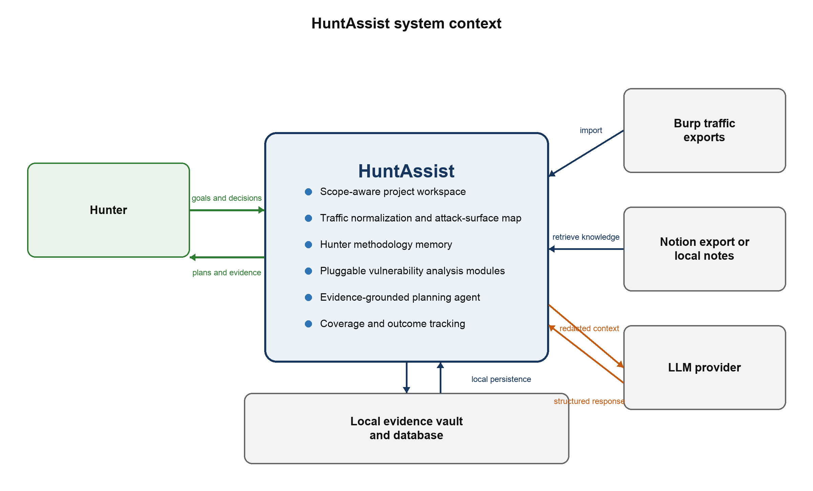

# HuntAssist

HuntAssist is a local Java workbench for reviewing previously captured HTTP traffic. Import a Burp XML export or HAR, browse scoped evidence, and collect defensive recommendations and follow-up decisions. The browser and terminal use the same services. The XSS module is the first implementation of the pluggable defensive review interface.

## Stage 1 deliverables

- [Complete GitHub-readable design report](docs/stage-1/README.md)
- [Submission-ready PDF](docs/stage-1/HuntAssist_Stage_1_Design_Report.pdf)
- [Editable DOCX](docs/stage-1/HuntAssist_Stage_1_Design_Report.docx)



## Build and run

Install JDK 21 and Maven 3.9 or later. From the repository root:

```sh
mvn clean verify
java -jar target/huntassist.jar --help
java -jar target/huntassist.jar serve
```

Open [the local workbench](http://127.0.0.1:8080/). Use `--port` on `serve` for a different port. The default store is `./local-data`. Use `--store DIRECTORY` with either interface for another workspace. Close the browser server before opening that same store from a standalone command.

### Terminal walkthrough

Create a demo project and copy its displayed ID into `PROJECT_ID`. Use the endpoint ID for `/catalog` from `surface list` as `ENDPOINT_ID`.

```sh
java -jar target/huntassist.jar project create --name "Course demo" --include shop.example.test
java -jar target/huntassist.jar traffic import --project PROJECT_ID --profile guest samples/traffic/guest.xml
java -jar target/huntassist.jar traffic import --project PROJECT_ID --profile member samples/traffic/member.json
java -jar target/huntassist.jar traffic history --project PROJECT_ID
java -jar target/huntassist.jar surface list --project PROJECT_ID --format json
java -jar target/huntassist.jar surface evidence --project PROJECT_ID --endpoint ENDPOINT_ID
java -jar target/huntassist.jar compare --project PROJECT_ID --first guest --second member
java -jar target/huntassist.jar knowledge import --project PROJECT_ID samples/knowledge/defensive-xss.md
java -jar target/huntassist.jar knowledge search --project PROJECT_ID "output encoding"
java -jar target/huntassist.jar modules list
java -jar target/huntassist.jar analyze --project PROJECT_ID --endpoint ENDPOINT_ID --module xss
java -jar target/huntassist.jar plan generate --project PROJECT_ID --endpoint ENDPOINT_ID
java -jar target/huntassist.jar ask --project PROJECT_ID --endpoint ENDPOINT_ID "How should I review output encoding?"
java -jar target/huntassist.jar coverage record --project PROJECT_ID --endpoint ENDPOINT_ID --state IN_REVIEW
java -jar target/huntassist.jar plan history --project PROJECT_ID
```

`--format json` emits a versioned result envelope. Progress and diagnostics go to stderr. Exit codes are `0` success, `2` invalid input, `3` missing resource, `4` refusal, `5` unavailable dependency, `6` store in use, `7` controlled failure, `10` unexpected failure, and `130` interruption. A valid `NOT_APPLICABLE` review is a successful result. A missing or invalid model response produces a labeled deterministic fallback.

### Enable the local model

The deterministic workflows run without model setup. For model-backed review, install [Ollama](https://ollama.com/download) and pull [Qwen2.5 0.5B Instruct](https://ollama.com/library/qwen2.5:0.5b-instruct), or choose a compatible local model. The application connects to `127.0.0.1:11434` and sends action codes and boolean observations. Model output can reorder eligible recommendations. All recommendation text and evidence links come from the application.

```sh
# Terminal 1
OLLAMA_HOST=127.0.0.1:11434 OLLAMA_NO_CLOUD=1 ollama serve

# Terminal 2
ollama pull qwen2.5:0.5b-instruct
HUNTASSIST_OLLAMA_MODEL=qwen2.5:0.5b-instruct java -jar target/huntassist.jar serve
```

`.env.example` lists the optional settings. If you use a shell environment file, copy it to `.env` and export its values before launching. HuntAssist requires no model API key.

## Implementation and testing

- [Stage 2 implementation report](docs/stage-2/stage2-report.pdf)
- [Browser demonstration](docs/stage-2/browser-demo.mp4) and [CLI demonstration](docs/stage-2/cli-demo.mp4)
- [Stage 3 behavior and verification notes](docs/stage-3/README.md)
- [KUMA evaluation instructions](evaluation/)
- [Synthetic walkthrough fixtures](samples/)

## Security and repository hygiene

Use captures you are authorized to review. The importer stores scoped route metadata, statuses, normalized media types, selected header-presence flags, and source indexes. It discards bodies and credential values. Keep captures, private notes, and local database files outside source control. The fixtures in `samples/` are synthetic.

Scope rules accept exact hosts and `*.domain` rules. Wildcards cover subdomains, and exclusions take precedence. The imported observations and XSS mitigation checks support a defensive review. A missing header or a difference between profiles is an observation to interpret in context.

