# HuntAssist Stage 1 Software and Agent Design

**Bug Bounty Traffic Analysis and Investigation Planning Agent**

EECS 3311 Software Design  
Course Project Stage 1  
Fall 2026

> Design before implementation

[Project overview](../../README.md) | [Submission-ready PDF](HuntAssist_Stage_1_Design_Report.pdf) | [Editable DOCX](HuntAssist_Stage_1_Design_Report.docx)

---

## Contents and Report Map

| Section | Purpose |
| --- | --- |
| Executive Summary | The proposed system, responsibility split, implementation style, and course-release boundary. |
| 1 Project Description and Scope | Problem, intended user, agent rationale, included work, exclusions, assumptions, and constraints. |
| 2 Requirements and Major Features | Nineteen functional requirements, thirteen quality requirements, and nine major features. |
| 3 Design Inputs and Knowledge Model | Evidence from the supplied Burp export and the structured use of the hunter's XSS notes. |
| 4 User Interaction | End-to-end workflow and local browser-interface concept. |
| 5 Actors and Use Cases | Actors, UML use-case diagram, and nine complete use-case specifications. |
| 6 System Architecture | Modular-monolith structure, agent boundary, tools, privacy, and persistence. |
| 7 Sequence Diagrams | Five major collaboration flows including alternative and failure behavior. |
| 8 Java Package and Class Design | Package responsibilities, four readable UML class views, and class responsibilities. |
| 9 Design Principles and Patterns | Object-oriented principles, patterns, and important design decisions. |
| 10 Feature to Design Mapping | How each feature is implemented by collaborating controllers, services, domain classes, ports, and adapters. |
| 11 Requirements Traceability | Requirement-to-feature-to-use-case-to-sequence-to-class mapping and planned tests. |
| 12 Risks and Mitigations | Security, privacy, safety, reliability, and schedule risks with design responses. |
| 13 Planned Implementation Structure | Java stack, delivery order, MVP fallback, and later extensions. |
| 14 Stage 1 Completion Checklist | Direct verification that every required Stage 1 artifact is present. |

## Executive Summary

HuntAssist is a local-first Java application for an individual bug bounty hunter working on assets for which they have explicit authorization. It imports HTTP traffic captured in Burp Suite, builds a structured attack-surface model, retrieves relevant techniques from the hunter's own methodology notes, and uses a bounded LLM agent to propose evidence-grounded investigations. The hunter reviews and performs every test. The course release does not send live requests, scan targets, or claim that a vulnerability has been confirmed.

The design divides responsibility deliberately. Deterministic Java components parse traffic, enforce program scope, normalize endpoints, redact secrets, compare controlled accounts, retrieve knowledge, preserve evidence, and track coverage. The LLM interprets a goal, selects read-only tools, connects observations to relevant methodology, and explains possible lines of investigation. A validator rejects unsupported references, out-of-scope material, unavailable actions, and statements that present a hypothesis as a confirmed bug.

The application is a modular monolith implemented with Java 21, Spring Boot, a local browser interface, H2 file storage, a separate evidence vault, and a Lucene knowledge index. Ports isolate Burp file formats, Notion or local notes, the LLM provider, storage, and future integrations. This structure supplies the abstraction, encapsulation, interfaces, polymorphism, dependency inversion, and traceability required by the project while remaining realistic for a semester implementation.

The first release focuses on imported Burp traffic and exported notes. Direct Notion synchronization and a Burp Montoya extension are planned adapters. The design therefore serves the course deliverable now and can continue growing into a practical hunting tool afterward.

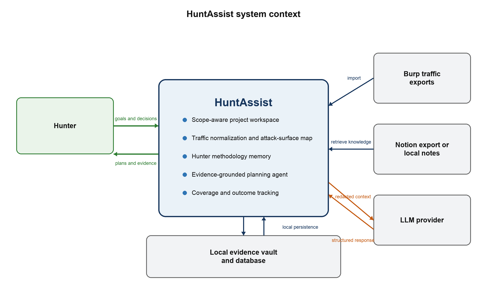

<em>Figure 1 HuntAssist system context and responsibility boundary</em>

## 1 Project Description and Scope

### 1.1 Problem

A bug bounty hunter collects a large amount of fragmented information while exploring a web application. Burp history contains requests and responses, personal notes contain techniques and payload constraints, and the hunter separately remembers which paths and roles have already been tested. On a large application, endpoints, parameters, multi-step workflows, and account states are easy to miss. Generic LLM conversations add another fragment: they can discuss a request, but they do not automatically maintain a verified attack-surface model, program scope, evidence provenance, or durable coverage state.

HuntAssist brings these sources into one project. It treats captured traffic as evidence, personal notes as versioned methodology, and LLM output as a hypothesis that must pass deterministic validation. The application helps the hunter decide where to spend attention while preserving the distinction between an observed fact, an agent interpretation, and a manually verified finding.

### 1.2 Intended User

The primary user is an individual bug bounty hunter performing authorized testing through a coordinated disclosure or bounty program. The user understands HTTP and Burp Suite, controls the accounts represented in the imported traffic, and remains responsible for program rules and live testing. The course evaluator is a secondary reader of the design, but not an application actor.

### 1.3 Why an Agent Is Appropriate

The application contains many deterministic tasks, but choosing a useful investigation path requires interpretation. The same parameter may deserve different tests depending on where it appears, how the response handles it, which role made the request, what the hunter has already tried, and which methodology sections apply. An LLM is useful for connecting that context and explaining a plan. It is not trusted to parse files, decide scope, handle secrets, establish evidence, or confirm a vulnerability. Those responsibilities remain in Java services.

### 1.4 Scope of the Course Release

- Create a local project for one bounty program and define authorized asset rules and restrictions.

- Import Burp XML and HAR traffic, with raw HTTP file support as time permits.

- Normalize and deduplicate requests while preserving the original evidence record.

- Build an endpoint, parameter, content-type, GraphQL, authentication-state, and account-role inventory.

- Import Markdown, HTML, text, or a Notion export as methodology knowledge.

- Retrieve relevant methodology sections for an endpoint, input context, category, or question.

- Compare traffic from two controlled test accounts or roles.

- Generate ranked, evidence-linked investigation hypotheses through read-only agent tools.

- Track coverage, hunter decisions, outcomes, and source versions across sessions.

### 1.5 Deferred and Excluded Work

Direct Notion synchronization, real-time Burp ingestion through Montoya, controlled request replay, local-model support, project sharing, and additional capture formats are planned extensions behind existing interfaces. They are not required for the first implementation.

The course release excludes autonomous exploitation, live scanning, brute force, credential attacks, denial of service, destructive payloads, testing outside the active program scope, automatic vulnerability confirmation, and automatic report submission. It also does not promise to reconstruct encrypted HTTPS from an ordinary PCAP without session secrets.

### 1.6 Assumptions and Constraints

- The hunter imports only material obtained during authorized testing and defines the active program scope accurately.

- The first version is a single-user application running locally on the hunter's computer.

- Java 21 is used for compatibility with the planned Spring application and a future Burp Montoya adapter.

- Imported notes are reference data, not trusted instructions for the LLM.

- Recommendations remain unverified hypotheses until the hunter performs and evaluates a test.

- A remote LLM receives minimized and redacted context only when the active RemoteModelPolicy explicitly permits that provider; otherwise model-backed features are unavailable and deterministic views continue to work.

- Performance values in this report are design targets and will be measured during implementation.

## 2 Requirements and Major Features

### 2.1 Functional Requirements

| ID | Requirement |
| --- | --- |
| FR-01 | Create a hunt project containing the program name, authorized assets, exclusions, and testing restrictions. |
| FR-02 | Classify every imported exchange as in scope, out of scope, or unresolved before it becomes available to the agent. |
| FR-03 | Detect a traffic file format from its contents and parse each supported format into one common HTTP exchange model. |
| FR-04 | Normalize and deduplicate exchanges while preserving links to every original capture record. |
| FR-05 | Build an attack-surface inventory of hosts, paths, methods, parameters, content types, status codes, GraphQL operations, and observed authentication states. |
| FR-06 | Allow the hunter to label traffic by controlled account, role, workflow, and investigation notes. |
| FR-07 | Import methodology documents from Markdown, HTML, plain text, or a Notion export and preserve document and section provenance. |
| FR-08 | Retrieve methodology sections relevant to a selected endpoint, input context, vulnerability category, or natural-language question. |
| FR-09 | Compare matched observations from two controlled accounts or roles and report factual request and response differences. |
| FR-10 | Generate ranked investigation hypotheses from scoped traffic, retrieved methodology, previous coverage, and the hunter's stated goal. |
| FR-11 | Attach resolvable traffic evidence and methodology citations to every endpoint-specific recommendation. |
| FR-12 | Reject agent output that is malformed, out of scope, unsupported by its cited records, or presented as a confirmed vulnerability. |
| FR-13 | Track coverage by endpoint, vulnerability category, account context, and result state. |
| FR-14 | Record whether the hunter accepted, modified, dismissed, attempted, or completed each recommendation. |
| FR-15 | Answer natural-language questions by using read-only application tools over imported project data. |
| FR-16 | Mask sensitive request and response headers and values before any context is sent to an external LLM. |
| FR-17 | Preserve import history, knowledge-source versions, agent runs, tool traces, and hunter decisions. |
| FR-18 | Recover predictably from unsupported files, malformed records, unavailable providers, invalid model output, and storage errors. |
| FR-19 | Enforce a per-project RemoteModelPolicy and block external model calls unless the program policy explicitly permits them. |

### 2.2 Nonfunctional Requirements

| ID | Quality | Requirement |
| --- | --- | --- |
| NFR-01 | Security | Cookie and Set-Cookie values, authorization headers, API keys, passwords, CSRF tokens, OAuth codes, and user-defined sensitive fields must be masked at the LLM boundary. |
| NFR-02 | Scope safety | The agent may query only records accepted by the active ProgramScope. Out-of-scope and unresolved records remain quarantined. |
| NFR-03 | Privacy | Raw requests and responses remain local. A remote model receives minimized, redacted evidence only when the active project's RemoteModelPolicy permits external processing; otherwise agent planning is disabled. |
| NFR-04 | Traceability | A hunter must be able to navigate from each recommendation to its source exchanges and methodology sections. |
| NFR-05 | Reliability | An import uses a recoverable staging area and commits as a complete batch or is marked failed. The interface must not present a partial import as complete. |
| NFR-06 | Responsiveness | Imports and model calls run asynchronously and expose progress and cancellation so the local web interface remains responsive. |
| NFR-07 | Performance | The design target is to import and index 10,000 ordinary exchanges within 60 seconds on a typical student laptop and return filtered local queries within two seconds, excluding model time. |
| NFR-08 | Portability | The application targets Java 21 and runs on Windows, macOS, and Linux with documented prerequisites. |
| NFR-09 | Maintainability | File formats, knowledge sources, storage, and LLM providers are accessed through interfaces so an adapter can change without changing domain logic. |
| NFR-10 | Testability | Application services accept injected repositories and provider interfaces so deterministic tests can use fakes and model behavior can be observed. |
| NFR-11 | Auditability | Logs record operations, validation failures, and tool calls without recording unredacted message bodies or secrets. |
| NFR-12 | Explainability | Recommendations state the hypothesis, rationale, prerequisites, uncertainty, expected observations, evidence, and methodology source. |
| NFR-13 | Local data protection | The evidence vault uses restrictive filesystem permissions, project deletion and retention controls, and optional encryption at rest with separately managed keys. |

### 2.3 Major Features

| Feature | Purpose |
| --- | --- |
| Program workspace and scope guard | Stores allowed assets, exclusions, forbidden actions, and policy notes. Every import, query, and recommendation is evaluated against this boundary. |
| Traffic ingestion and normalization | Streams Burp XML or HAR data into a common model, detects the real format from file content, decodes messages, sanitizes previews, and preserves source provenance. |
| Attack-surface map | Groups observations into canonical endpoints and exposes methods, input points, content types, authentication context, GraphQL operations, and coverage gaps. |
| Methodology memory | Imports the hunter's notes and turns headings and sections into searchable knowledge chunks with source, version, and applicability metadata. |
| Evidence-grounded hunt planner | Uses a bounded LLM tool loop to retrieve project evidence and relevant methodology before proposing ranked investigations. |
| Account and role comparison | Matches equivalent requests from controlled accounts and reports deterministic differences that may deserve authorization testing. |
| Coverage and outcome tracking | Stores what was planned, attempted, dismissed, inconclusive, or manually confirmed so the agent does not repeatedly suggest the same work. |
| Natural-language investigation | Lets the hunter ask project-specific questions while the agent obtains facts through read-only tools instead of relying on model memory. |
| Privacy and provenance controls | Keeps raw evidence local, redacts model context, validates citations, and records the source and version of every observation. |

## 3 Design Inputs and Knowledge Model

### 3.1 Validation Against the Provided Traffic

The supplied sample validates the need for format detection and careful privacy controls. Although its filename ends in .pcap, its contents are a Burp Suite XML export containing 90 HTTPS request and response pairs. The export is about 9 MB, stores complete raw HTTP request and response messages as Base64, contains 42 distinct method-host-path combinations, and includes substantial JSON and GraphQL traffic. Eighty-six requests contain Cookie headers, and responses also contain Set-Cookie material. These properties make streaming parsing, content-based format selection, local raw-message storage, GraphQL-aware analysis, and two-sided secret redaction explicit design requirements.

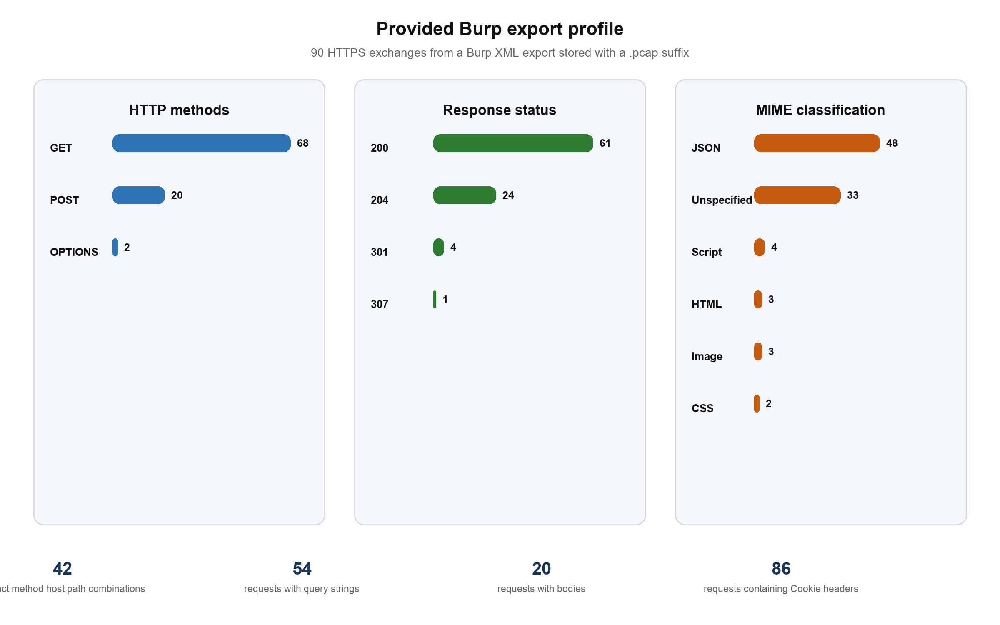

<em>Figure 2 Aggregate profile of the provided Burp export without endpoint names or sensitive values</em>

Burp XML is more useful to this application than a normal network PCAP because Burp has already captured the decrypted HTTP messages. A genuine HTTPS PCAP normally exposes connection metadata but not application requests and responses unless compatible TLS session secrets are available. PcapMetadataImporter therefore remains optional and cannot be treated as equivalent to Burp XML ingestion.

### 3.2 Personal Methodology as Structured Memory

The supplied Notion page Payloads XSS contains more than payload strings. It records circumstances such as HTML and attribute contexts, JavaScript expressions, URL-bearing attributes, path reflection, encoding order, XML or SVG handling, and syntax restrictions. The software should preserve those circumstances so retrieval can select a relevant technique instead of sending an entire page to the LLM.

A KnowledgeDocument represents one imported page or file version. KnowledgeChunk represents a heading-aware section with its text, code blocks, category, context tags, source path, source URL or file reference, content hash, and review state. An optional methodology-card view adds fields for applicability conditions, technique summary, expected signals, and stopping conditions. The hunter can approve or correct extracted tags before the source is used for planning.

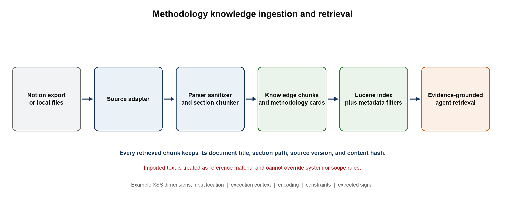

<em>Figure 3 Methodology ingestion keeps context and provenance through retrieval</em>

### 3.3 Example XSS Methodology Record

| Field | Example value |
| --- | --- |
| Category | Reflected XSS investigation |
| Applicability | A user-controlled query, path, or body value is observed in a text/html response. |
| Context signals | HTML element, quoted attribute, URI-bearing attribute, JavaScript string or expression, style block, or XML/SVG response. |
| Constraints | Observed encoding, quote type, character restrictions, path-segment rules, response MIME type, and interaction requirement. |
| Procedure | Begin with a harmless canary, locate and classify the reflection, retrieve compatible techniques, and plan manual validation. |
| Evidence required | Input-point ID, response evidence ID, reflection location, and knowledge-section citation. |
| Result | A hypothesis and expected observation. The record never marks a vulnerability confirmed. |

## 4 User Interaction

### 4.1 Primary Workflow

1. Create a project and define the program scope before importing target data.

2. Import a Burp export and review accepted, duplicate, invalid, unresolved, and quarantined records.

3. Label controlled account sessions and inspect the generated attack-surface map.

4. Import methodology notes and approve the sections and tags available to the planner.

5. Select endpoints, workflows, roles, or a vulnerability category and request an investigation plan.

6. Open each suggestion, inspect the traffic and methodology evidence, and decide whether to pursue it manually.

7. Record the result so coverage and future planning reflect what was actually tested.

### 4.2 Interface Structure

The course release uses a local Spring Boot server with a Thymeleaf interface opened in the user's browser. This keeps business logic in Java, avoids a separate JavaScript application, and leaves the core available to a future Burp extension. The main views are Overview, Traffic Imports, Attack Surface, Knowledge, Hunt Plans, Coverage, and Settings.

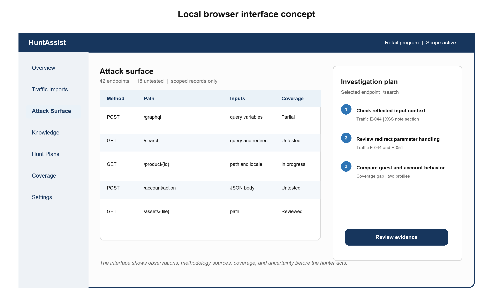

<em>Figure 4 Proposed local interface with attack-surface evidence and a reviewable hunt plan</em>

The interface keeps scope visible, presents the source of every recommendation, and makes uncertainty explicit. It does not hide the underlying request and response evidence behind a conversational answer.

## 5 Actors and Use Cases

### 5.1 Actors

| Actor | Role |
| --- | --- |
| Bug bounty hunter | Primary actor who defines scope, imports data, requests analysis, reviews evidence, performs testing, and records results. |
| Burp export | External source of captured HTTP request and response records. |
| Methodology source | A local file or exported Notion workspace that supplies the hunter's reusable testing knowledge. |
| LLM provider | Interprets goals and tool results and returns a structured plan. It has no direct access to project storage or the target. |

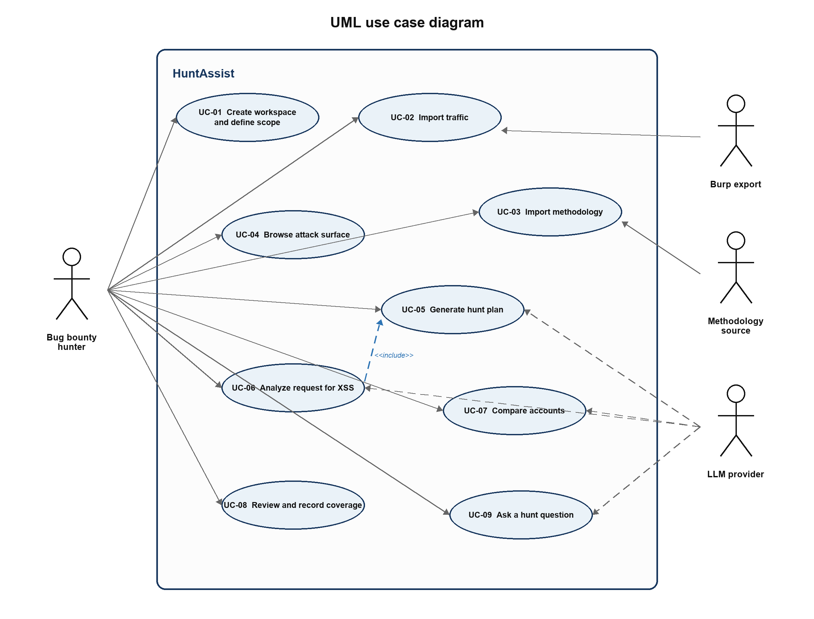

<em>Figure 5 Use case diagram for the HuntAssist course release</em>

### 5.2 Detailed Use Cases

#### UC-01 Create a Program Workspace

| Field | Specification |
| --- | --- |
| Primary actor | Bug bounty hunter |
| Goal | Establish the authorized testing boundary and restrictions for one hunt. |
| Preconditions | The application is running and local storage is available. |
| Trigger | The hunter selects New Program Workspace. |

##### Main success scenario

1. The system asks for the program name, included assets, exclusions, forbidden actions, relevant policy notes, and whether the program permits external AI processing.

2. The hunter enters exact hosts, wildcard host rules, optional URL prefixes, and restrictions such as request-rate limits.

3. The system validates the syntax and identifies contradictory or overly broad rules.

4. ProgramScope compiles the accepted rules into deterministic matchers.

5. ProjectService saves the workspace, including its RemoteModelPolicy, and makes it active.

6. The interface displays a plain-language summary of the effective scope.

##### Alternative and exception flows

- A rule is malformed: the affected field is identified and the project is not activated until it is corrected.

- An asset matches both an inclusion and exclusion: the exclusion wins and the conflict is shown.

- No included asset is supplied: the system refuses to activate the workspace.

- Storage fails: no partial workspace becomes active and the error is logged without secrets.

**Postconditions.** A valid active project exists and all later operations use its ProgramScope.

#### UC-02 Import Burp Traffic

| Field | Specification |
| --- | --- |
| Primary actor | Bug bounty hunter with a Burp export file |
| Goal | Convert captured HTTP traffic into a structured attack-surface model. |
| Preconditions | An active project exists and the selected file was produced from authorized testing. |
| Trigger | The hunter selects Import Traffic and chooses a file. |

##### Main success scenario

1. TrafficFormatDetector examines the file signature and root structure instead of trusting its extension.

2. TrafficImporterRegistry selects BurpXmlTrafficImporter, HarTrafficImporter, or another supported adapter.

3. The importer streams records, decodes Base64 raw HTTP messages where needed, and gives each source record an EvidenceRef in an import-session staging area.

4. HttpMessageParser extracts request lines, status lines, headers, bodies, and parameter locations.

5. SensitiveDataRedactor creates prompt-safe views while the raw messages go to the local EvidenceVault.

6. ProgramScope classifies every exchange as in scope, out of scope, or unresolved.

7. EndpointCanonicalizer and duplicate detection build stable endpoint observations without discarding source records.

8. TrafficRepository commits normalized metadata in H2 and the service atomically finalizes the staged evidence-vault directory.

9. AttackSurfaceService updates endpoints, parameters, GraphQL operations, authentication observations, and summary counts.

10. The interface reports imported, duplicate, invalid, quarantined, and unresolved records.

##### Alternative and exception flows

- The file has a misleading extension: content detection still selects the correct parser.

- The format is unsupported: the import stops and lists the accepted formats.

- A row is malformed: strict mode rejects the batch; tolerant mode records the row error and continues.

- The same capture hash already exists: the system offers to skip it or import it as a new version.

- Encrypted HTTPS is supplied as a genuine PCAP without TLS secrets: the system explains that application-layer reconstruction is unavailable.

- The operation is cancelled or storage fails: staged evidence is discarded or recovered at startup and the batch remains failed.

**Postconditions.** Valid scoped exchanges and source references are stored, the attack-surface map is current, and no live request has been sent.

#### UC-03 Import Methodology Notes

| Field | Specification |
| --- | --- |
| Primary actor | Bug bounty hunter with a local note export |
| Goal | Add reusable personal testing knowledge to the agent's methodology memory. |
| Preconditions | A project is active and a supported Markdown, HTML, text, or Notion export is available. |
| Trigger | The hunter selects Add Methodology Source. |

##### Main success scenario

1. LocalDocumentKnowledgeSource reads the selected document or export directory.

2. DocumentNormalizer preserves headings, code blocks, lists, links, and source metadata.

3. KnowledgeSanitizer marks imported text as untrusted reference data and removes detected secrets.

4. KnowledgeChunker creates section-aware chunks and retains each section path.

5. Optional technique extraction assigns vulnerability category, input location, execution context, constraints, and expected signals.

6. KnowledgeRepository stores and commits the source hash, version, chunks, and citations as the canonical H2 record.

7. LuceneKnowledgeIndex builds a rebuildable search projection and marks the source Indexed, Index Pending, or Index Failed.

8. The interface displays imported sections and sample retrieval results for hunter review.

9. The hunter approves the source for planning use.

##### Alternative and exception flows

- A future Notion adapter cannot connect: the prior version remains active and the hunter can use an exported file.

- The file is unsupported, empty, or unchanged: no index update is committed.

- Sensitive material is detected: the source can be rejected or marked local-only.

- Optional model-based tagging fails: raw section chunks remain searchable and the source is marked partially processed.

- Prompt-like text appears inside a note: it remains quoted source content and cannot change system rules.

**Postconditions.** A versioned and approved methodology source is searchable, with provenance for every returned section.

#### UC-04 Browse the Attack Surface

| Field | Specification |
| --- | --- |
| Primary actor | Bug bounty hunter |
| Goal | Understand the observed application surface and locate untested areas. |
| Preconditions | The active project contains at least one successful traffic import. |
| Trigger | The hunter opens Attack Surface. |

##### Main success scenario

1. AttackSurfaceService loads only scoped endpoints for the active project.

2. The interface groups records by host, normalized path, method, content type, GraphQL operation, and authentication state.

3. The hunter filters by parameter, response status, account, workflow, vulnerability category, or coverage status.

4. The hunter selects an endpoint.

5. The system displays its observed exchanges, input points, response summary, source references, account observations, and coverage.

6. The hunter can open a sanitized evidence view or request a plan for the selected endpoint.

##### Alternative and exception flows

- No scoped records exist: the interface directs the hunter to import traffic or correct unresolved scope rules.

- The original source file was removed: normalized evidence remains visible and the source-file link is marked unavailable.

- A filter returns no results: the active filters remain visible and can be cleared individually.

**Postconditions.** The selected endpoint context is ready for analysis; the hunt state changes only when the hunter adds a label or note.

#### UC-05 Generate a Prioritized Investigation Plan

| Field | Specification |
| --- | --- |
| Primary actor | Bug bounty hunter supported by an LLM provider |
| Goal | Receive ranked investigation hypotheses grounded in traffic, methodology, and coverage. |
| Preconditions | A valid project, scoped traffic, indexed methodology, configured LLM gateway, and a RemoteModelPolicy that permits the selected provider exist. |
| Trigger | The hunter selects a host, workflow, endpoint set, or category and chooses Generate Plan. |

##### Main success scenario

1. HuntPlanningService creates a PlanningRequest containing the hunter's goal and selected target IDs.

2. PlanningContextBuilder supplies the agent with scope and a small set of project metadata.

3. AgentLoop exposes read-only tools for scope, attack surface, evidence, methodology, account comparison, and coverage.

4. The LLM requests tools; ToolRegistry validates every argument before execution.

5. The tools return minimized objects with stable evidence and knowledge IDs.

6. The loop stops after a configured number of steps and requires a structured final plan.

7. PlanOutputValidator checks schema, scope, references, forbidden claims, and available actions.

8. SuggestionRanker calculates deterministic priority using evidence strength, novelty, knowledge relevance, and coverage.

9. HuntingRepository saves the valid plan, tool trace, provider metadata, and validation result.

10. The interface displays each hypothesis with rationale, prerequisites, uncertainty, evidence, and methodology citations.

##### Alternative and exception flows

- Required context is missing: the system explains which traffic, knowledge, or account labels are needed.

- A tool fails: the agent retries once where safe or produces a clearly limited result.

- The LLM is unavailable: the planning request is saved for retry and deterministic views remain usable.

- The active RemoteModelPolicy prohibits external processing: the run is blocked before target context leaves the application; deterministic analysis remains available.

- Output is malformed: one repair attempt is allowed; otherwise the run fails without saving recommendations.

- A candidate cites missing or out-of-scope evidence, claims a confirmed vulnerability, or implies a live action: that candidate is rejected.

- The maximum tool-step limit is reached: the run ends with a controlled failure or a partial plan labeled incomplete.

**Postconditions.** A validated, evidence-linked hunt plan is stored; the application has not contacted the target.

#### UC-06 Analyze a Request Using XSS Methodology

| Field | Specification |
| --- | --- |
| Primary actor | Bug bounty hunter supported by an LLM provider |
| Goal | Apply the hunter's XSS methodology to a selected request and its observed response context. |
| Preconditions | The exchange is scoped and an approved XSS knowledge source has been indexed. |
| Trigger | The hunter selects Analyze for XSS on an endpoint or exchange. |

##### Main success scenario

1. ContextAnalysisService extracts input points, parameter locations, response content type, reflection observations, and encoding signals.

2. SearchKnowledgeTool retrieves XSS sections matching the observed location and context.

3. GetCoverageTool returns previous XSS work for the endpoint and account context.

4. The agent maps only applicable knowledge to the evidence and separates observations from hypotheses.

5. It proposes a small set of manual checks, prerequisites, expected signals, stopping conditions, and source citations.

6. PlanOutputValidator confirms the endpoint, evidence references, knowledge citations, and scope.

7. The hunter accepts, edits, or dismisses each suggestion.

##### Alternative and exception flows

- No user-controlled input or reflection is observed: the system explains why it cannot form an evidence-based XSS lead.

- The response is binary or unavailable: response-context analysis is omitted and uncertainty is increased.

- No methodology section matches: the result contains traffic observations only and states that methodology support is absent.

- The knowledge source contains an unsupported claim: provenance remains visible and the agent cannot treat it as verified fact.

- Scope validation fails: the analysis is blocked before the LLM receives target details.

**Postconditions.** Reviewed XSS investigation ideas and their provenance are saved; no payload has been submitted automatically.

#### UC-07 Compare Accounts or Roles

| Field | Specification |
| --- | --- |
| Primary actor | Bug bounty hunter |
| Goal | Identify factual access differences that may justify manual authorization testing. |
| Preconditions | Traffic from at least two controlled test accounts or roles is imported and labeled. |
| Trigger | The hunter selects two profiles and chooses Compare Access. |

##### Main success scenario

1. AuthorizationComparisonService retrieves scoped exchanges for both account profiles.

2. RequestMatcher groups equivalent endpoints, GraphQL operations, and workflow steps.

3. ResponseComparator compares status, normalized structure, selected headers, object identifiers, and body fingerprints.

4. Configured ignored fields suppress timestamps, nonces, and other dynamic noise.

5. The deterministic analyzer reports missing, additional, or materially different observations.

6. The agent retrieves authorization methodology relevant to the observed differences.

7. It creates investigation hypotheses linked to evidence from both profiles.

8. The hunter reviews and records which comparisons deserve manual verification.

##### Alternative and exception flows

- A profile is unlabeled: the system asks the hunter to assign its account and role first.

- There are too few equivalent requests: the comparison reports insufficient evidence rather than a vulnerability.

- Dynamic data dominates the response: the user can add ignored-field rules and rerun the comparison.

- Only one profile accessed an endpoint: the system records a coverage gap instead of claiming unauthorized access.

- The LLM is unavailable: the deterministic comparison remains available without agent interpretation.

**Postconditions.** A saved comparison and reviewed authorization hypotheses exist; no bypass has been claimed or executed.

#### UC-08 Review a Recommendation and Record Coverage

| Field | Specification |
| --- | --- |
| Primary actor | Bug bounty hunter |
| Goal | Evaluate an investigation hypothesis and preserve the result of manual testing. |
| Preconditions | At least one recommendation exists. |
| Trigger | The hunter opens a recommendation. |

##### Main success scenario

1. HuntPlanningService loads the recommendation, source exchanges, methodology sections, and original tool trace.

2. The interface presents sanitized evidence and clearly distinguishes observations from agent interpretation.

3. The hunter marks the TestIdea accepted, edited, dismissed, or completed.

4. The hunter separately records a CoverageOutcome such as attempted, inconclusive, not vulnerable, possible finding, or manually confirmed, and may attach supporting EvidenceRefs.

5. CoverageService updates the endpoint, category, and account-context CoverageRecord after human review.

6. The decision is stored as hunt history and may be included in later planning context.

7. The attack-surface and planning views refresh.

##### Alternative and exception flows

- Evidence has been deleted or is unavailable: the recommendation remains but is marked as missing evidence.

- The methodology source has changed: the interface shows both the version used by the agent and the current version.

- A conflicting coverage result exists: the system appends history and asks which state should be current.

- Storage fails: the previous state remains unchanged and the hunter's unsaved text stays visible for retry.

**Postconditions.** The decision, coverage state, attached evidence, and audit history are saved.

#### UC-09 Ask a Natural Language Hunt Question

| Field | Specification |
| --- | --- |
| Primary actor | Bug bounty hunter supported by an LLM provider |
| Goal | Query imported traffic, methodology, and coverage without manually constructing filters. |
| Preconditions | The active project contains relevant data, the LLM gateway is configured, and RemoteModelPolicy permits the selected provider. |
| Trigger | The hunter asks a project-specific question. |

##### Main success scenario

1. HuntPlanningService passes the question, project ID, and current selection to AgentLoop.

2. The agent selects read-only tools from ToolRegistry.

3. The tools query scoped attack-surface, evidence, coverage, and methodology repositories.

4. The LLM synthesizes an answer using the returned records.

5. PlanOutputValidator confirms that every cited ID exists and belongs to the active project.

6. The interface displays the answer with navigable references and an option to save it as a hunt note.

##### Alternative and exception flows

- The question is ambiguous: the system asks one focused clarification.

- No matching records exist: the system reports no evidence instead of inventing an answer.

- A tool is unavailable: the answer states the missing source and does not substitute general model knowledge for project facts.

- The answer cites unknown records: it is rejected and repaired once before the run fails.

**Postconditions.** The answer and optional saved note exist; project data and scope remain unchanged.

## 6 System Architecture

### 6.1 Architectural Style

HuntAssist is a modular monolith using ports and adapters. A single deployment is appropriate for a local single-user tool and avoids the operational cost of microservices. Within that process, the web layer, application services, domain objects, agent loop, ports, and adapters are separated so external technology does not control domain design.

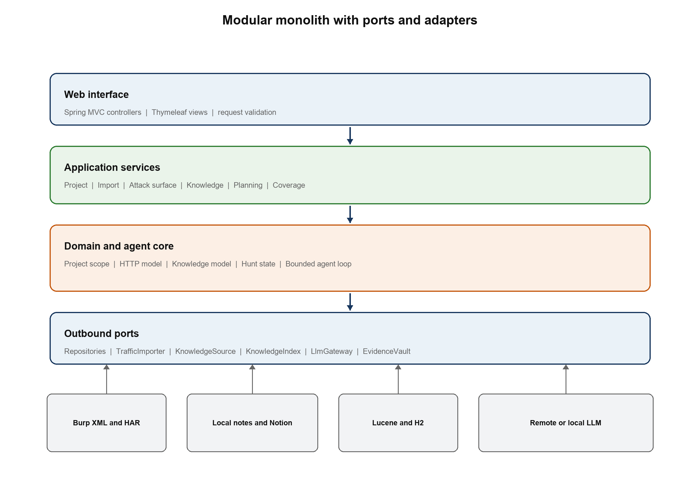

<em>Figure 6 Layered modular monolith and replaceable outbound adapters</em>

### 6.2 Deterministic and Nondeterministic Responsibilities

| Responsibility | Deterministic Java components | LLM agent |
| --- | --- | --- |
| Traffic | Parse, normalize, deduplicate, scope, redact, persist, and query. | Choose which scoped evidence tool to call for the hunter's goal. |
| Knowledge | Import, chunk, tag, index, retrieve, version, and cite source sections. | Connect applicable methodology to observed application context. |
| Comparison | Match operations and calculate factual account or response differences. | Explain which differences may justify manual investigation. |
| Planning | Expose typed tools, validate arguments, enforce limits, rank results, and save audit history. | Plan tool use and draft hypotheses with rationale and uncertainty. |
| Safety | Enforce scope, redact secrets, reject invalid references and unavailable actions. | Follow the tool and output contract; it cannot bypass Java safeguards. |
| Conclusion | Store the hunter's result and coverage state. | Never confirm a vulnerability. |

### 6.3 Agent Operation

AgentLoop receives a PlanningRequest and a bounded session. It exposes only typed read-only tools, validates each tool call, limits the number of steps, and requires a structured final plan. Each tool depends on a narrow, scope-filtered query port rather than an unrestricted repository. The model never receives database credentials, repository objects, raw file paths, or a general network tool. RemoteModelPolicy is checked before context construction, and PlanOutputValidator resolves every evidence and knowledge identifier before a result is stored.

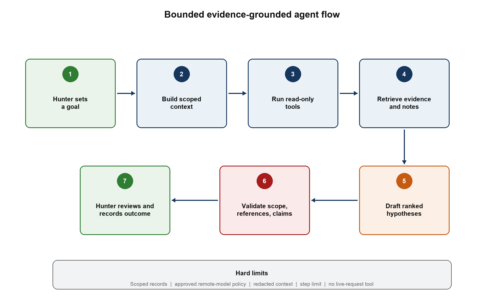

<em>Figure 7 Agent workflow with deterministic scope, redaction, validation, and human review</em>

### 6.4 Agent Tools

| Tool | Purpose | Deterministic checks |
| --- | --- | --- |
| SearchAttackSurfaceTool | Find endpoints and input points by method, parameter, MIME type, account, or coverage. | Project and scope filters are mandatory. |
| GetExchangeEvidenceTool | Return a sanitized view of selected requests and responses. | Evidence IDs must exist, belong to the project, and be in scope. |
| SearchKnowledgeTool | Retrieve methodology sections by category and observed context. | Every result includes source, section, version, and hash. |
| CompareAccountObservationsTool | Return factual differences across controlled accounts or roles. | Both profiles and matched EvidenceRefs are validated. |
| GetCoverageTool | Identify previous tests and remaining gaps. | Coverage states come from stored hunter decisions. |

### 6.5 Data, Privacy, and Persistence Architecture

H2 stores normalized project, endpoint, knowledge, coverage, recommendation, and audit metadata. Full raw messages are stored through EvidenceVault outside ordinary logs and prompts. EvidenceRef connects normalized records to raw data without embedding secrets in every table. The local vault uses owner-only filesystem permissions, explicit project deletion and retention controls, and optional encryption at rest with keys kept outside the vault. SensitiveDataRedactor masks both request and response secrets and produces an allowlisted prompt view.

Traffic import cannot atomically commit H2 and files in one database transaction, so ImportSession stages evidence in a temporary project directory, validates the batch, commits H2 metadata, and then atomically finalizes the staged directory. Startup recovery detects abandoned staging directories and either completes or removes them. H2 is also the canonical knowledge store; Lucene is a disposable search projection that can be rebuilt after an Index Pending or Index Failed state.

The model provider is replaceable. RemoteModelPolicy records whether the program permits third-party processing and blocks LlmGateway when it does not. When allowed, only minimized and redacted context is sent. A later local adapter can implement the same gateway. Each AgentRun records the provider, exposed model identifier, prompt-template version, tool trace, validation outcome, and policy decision.

## 7 Sequence Diagrams

The following diagrams expose the participating objects and ordered interactions behind the major use cases. Each flow includes a deterministic error path rather than reducing execution to User, Agent, and LLM.

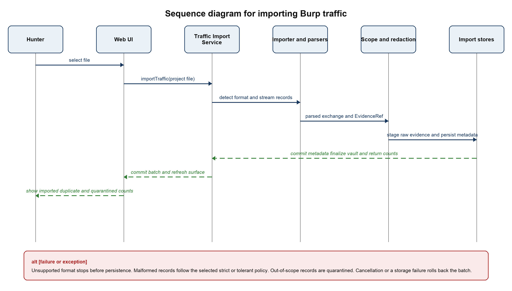

<em>Figure 8 SD-01 Import Burp traffic</em>

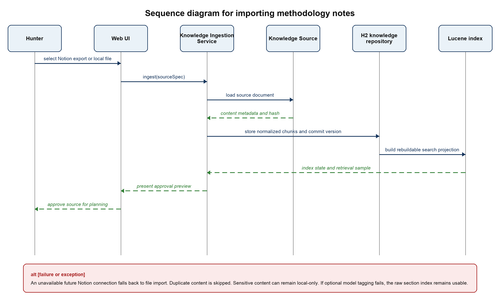

<em>Figure 9 SD-02 Import methodology notes</em>

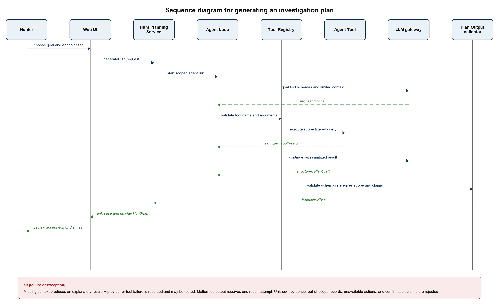

<em>Figure 10 SD-03 Generate an investigation plan</em>

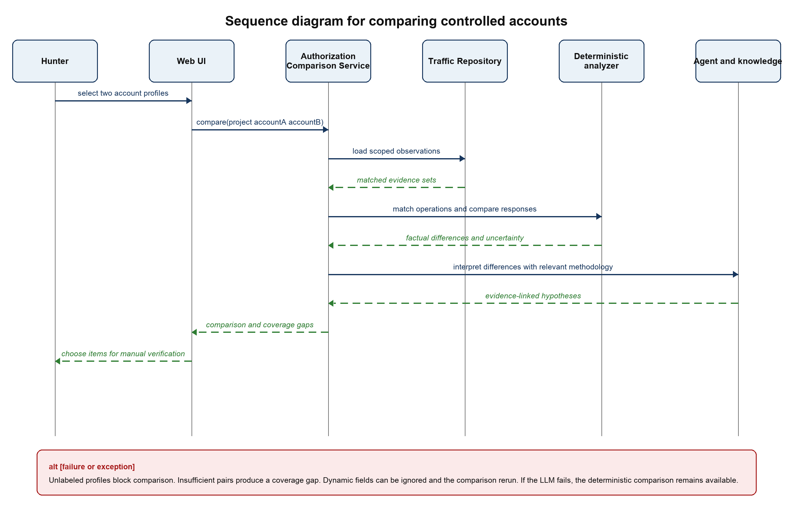

<em>Figure 11 SD-04 Compare controlled accounts or roles</em>

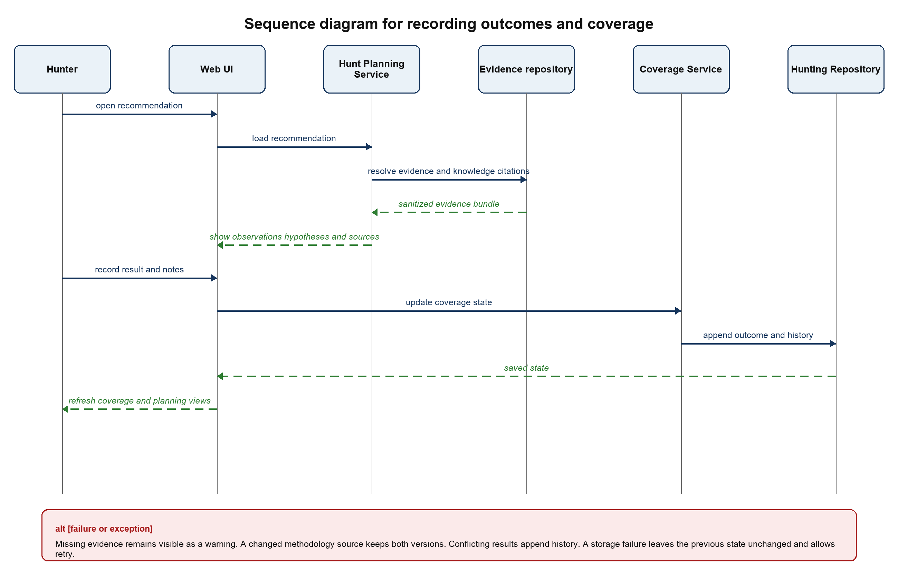

<em>Figure 12 SD-05 Review a recommendation and update coverage</em>

## 8 Java Package and Class Design

### 8.1 Recommended Size

The first implementation should use approximately ten logical packages and 32 to 40 production types. The count includes classes, interfaces, Java records, and enums but excludes simple web DTOs, framework configuration, and generated migration code. The main UML diagram shows the 24 to 28 types that determine behavior; small value records do not need to clutter the diagram. This is enough structure to demonstrate meaningful software design without turning the project into a collection of artificial one-method classes.

### 8.2 Package Responsibilities

| Package | Responsibility | Representative types |
| --- | --- | --- |
| ca.yorku.eecs3311.huntassist.web | HTTP controllers, Thymeleaf views, DTO validation, exception mapping, and a test-only evaluation boundary. | ProjectController, ImportController, AttackSurfaceController, KnowledgeController, PlanningController, CoverageController, AgentEvaluationEndpoint |
| application | Coordinates use cases and transaction boundaries without depending on UI or provider details. | ProjectService, TrafficImportService, AttackSurfaceService, KnowledgeIngestionService, ContextAnalysisService, AuthorizationComparisonService, HuntPlanningService, CoverageService |
| domain.project | Project aggregate, authorization scope, program restrictions, controlled accounts, and external-processing policy. | HuntProject, ProgramScope, AssetRule, AccountProfile, RemoteModelPolicy |
| domain.traffic | Normalized HTTP observations and provenance independent of Burp or HAR formats. | ImportSession, HttpExchange, Endpoint, ParameterObservation, EvidenceRef |
| domain.knowledge | Versioned methodology sources and retrievable section-level knowledge. | KnowledgeDocument, KnowledgeChunk, KnowledgeCitation |
| domain.hunting | Investigation ideas, coverage state, agent runs, and tool traces. | TestIdea, CoverageRecord, AgentRun, ToolTrace |
| agent | Bounded planning loop, read-only tools, structured validation, and deterministic ranking. | AgentLoop, PlanningContextBuilder, ToolRegistry, AgentTool implementations, PlanDraft, PlanOutputValidator, SuggestionRanker |
| port | Narrow interfaces that invert dependencies and enforce project and scope filters at query boundaries. | TrafficImporter, KnowledgeSource, LlmGateway, KnowledgeIndex, EvidenceVault, AttackSurfaceQuery, EvidenceQuery, CoverageQuery, AccountComparisonQuery, repository interfaces |
| adapter.importer and adapter.knowledge | Concrete traffic and methodology connectors selected through Strategy and Adapter patterns. | BurpXmlTrafficImporter, HarTrafficImporter, LocalDocumentKnowledgeSource, LuceneKnowledgeIndex, future NotionKnowledgeSource |
| adapter.ai and adapter.persistence | Provider-specific LLM access, H2 repositories, migrations, and the local evidence vault. | ProviderLlmGateway, H2 repository adapters, LocalEvidenceVault |

### 8.3 Domain Classes

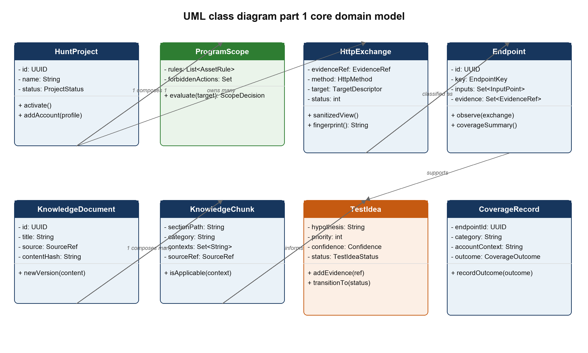

<em>Figure 13 UML class diagram part 1 showing the core domain model</em>

### 8.4 Application Services

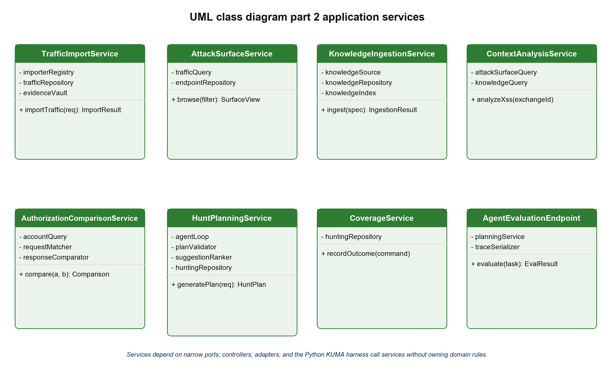

<em>Figure 14 UML class diagram part 2 showing application-service responsibilities</em>

### 8.5 Agent Ports and Adapters

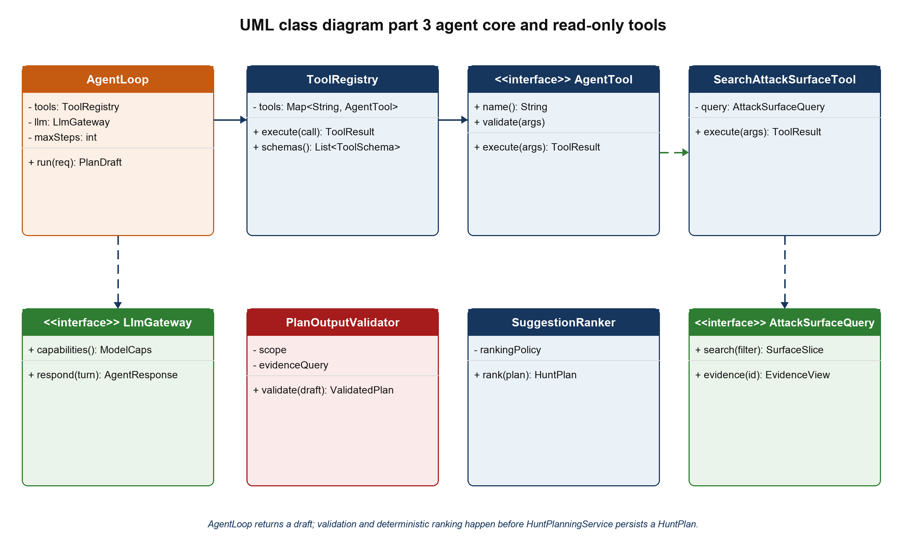

<em>Figure 15 UML class diagram part 3 showing the agent core and a representative read-only tool</em>

#### 8.5 Agent Ports and Adapters Continued

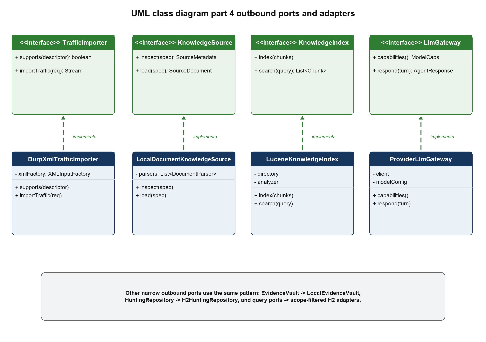

<em>Figure 16 UML class diagram part 4 showing outbound-port realizations</em>

### 8.6 Important Class Responsibilities

| Class or interface | Responsibility |
| --- | --- |
| HuntProject | Aggregate root that owns project identity, status, scope, account profiles, and references to project data. |
| ProgramScope | Composes asset rules and forbidden actions and returns a ScopeDecision for targets and evidence. |
| HttpExchange | Represents one normalized request and response observation with sanitized metadata and an EvidenceRef. |
| Endpoint | Represents a canonical entry point and aggregates observed inputs, accounts, response traits, and evidence. |
| KnowledgeDocument | Represents one versioned source file or Notion page. |
| KnowledgeChunk | Represents one retrievable section with text, context tags, provenance, and review state. |
| TestIdea | Represents a hypothesis with rationale, prerequisites, expected observations, evidence, citations, priority, confidence, and lifecycle state. |
| CoverageRecord | Connects endpoint, category, and account context to the hunter's current result and history. |
| ContextAnalysisService | Calculates reflection, encoding, MIME, and input-location signals before XSS methodology is retrieved. |
| HuntPlanningService | Coordinates AgentLoop, plan validation, deterministic ranking, persistence, and natural-language investigation. |
| RemoteModelPolicy | Records whether the active program permits external AI processing and which providers are allowed. |
| TrafficImporter | Strategy interface implemented by file-format adapters. |
| KnowledgeSource | Adapter interface implemented by local files now and Notion synchronization later. |
| LlmGateway | Provider-neutral boundary for structured agent turns. |
| EvidenceVault | Stores and retrieves raw evidence without exposing it to normal logs or prompts. |
| AgentLoop | Runs the bounded tool-calling state machine and stops on a final plan, failure, or step limit. |
| PlanOutputValidator | Rejects unresolved citations, scope violations, forbidden claims, missing fields, and unavailable actions. |
| SuggestionRanker | Assigns investigation priority from deterministic factors; it does not estimate whether a bug exists. |
| AgentEvaluationEndpoint | Test-only boundary that lets a Python KUMA harness run tasks and collect structured results and tool traces. |

## 9 Design Principles and Patterns

| Principle or pattern | Application in HuntAssist |
| --- | --- |
| Abstraction | HttpExchange, Endpoint, KnowledgeChunk, and TestIdea represent stable concepts independent of Burp XML, Notion, or a model provider. |
| Encapsulation | ProgramScope owns scope evaluation; CoverageRecord owns valid state transitions; raw evidence is accessed only through EvidenceVault. |
| Separation of concerns | Controllers handle HTTP, services coordinate use cases, domain objects hold rules, adapters handle external technology, and the LLM performs interpretation. |
| High cohesion | Each service coordinates one family of use cases and each analyzer performs one deterministic analysis. |
| Low coupling | Application and domain packages depend on ports rather than Spring Data, Lucene, Notion, Burp, or a specific LLM SDK. |
| Dependency inversion | TrafficImporter, KnowledgeSource, KnowledgeIndex, LlmGateway, EvidenceVault, and repositories are interfaces owned by the core. |
| Polymorphism and Strategy | BurpXmlTrafficImporter and HarTrafficImporter are selected through the same TrafficImporter contract; knowledge and model adapters work the same way. |
| Repository | Persistence adapters implement domain-oriented repository interfaces and hide H2 and JPA details. |
| Registry and Factory | TrafficImporterRegistry selects a parser from actual file content; ToolRegistry resolves validated agent commands. |
| Command | Each AgentTool is a typed, auditable command with argument validation and a bounded result. |
| Specification | AssetRule instances compose into ProgramScope and can be unit-tested independently. |
| State | TestIdea and CoverageRecord use explicit enums and guarded transitions rather than unstructured status strings. |

### 9.1 Important Design Decisions

Local Spring Boot application. A browser interface provides searchable tables and evidence panels while preserving a Java implementation. It is easier to test and extend than a large desktop UI, and the core can later be reused by a Montoya extension.

Offline first course release. The agent analyzes imported evidence and recommends manual tests. Removing a live network tool keeps authorization, rate limits, and target behavior under the hunter's control while still demonstrating planning, memory, retrieval, and tool use.

Structured knowledge instead of one memory file. Notes remain versioned documents and section-level chunks. Retrieval selects relevant material, citations remain visible, and a single large prompt cannot erase provenance or exceed context limits.

Structured agent output. TestIdea is a schema with evidence IDs, citations, prerequisites, expected observations, confidence, and state. Free-form prose may explain the idea, but cannot replace the fields that validation and traceability require.

Raw and derived evidence are separated. The evidence vault protects full messages; the database stores sanitized metadata and stable references. This limits accidental disclosure and keeps local analysis efficient.

Remote model use is a project policy decision. RemoteModelPolicy records whether a program permits third-party AI processing. LlmGateway is blocked unless that policy explicitly allows the selected provider; redaction alone is not treated as permission to disclose program data.

Cross-store operations use recoverable projections and staging. Traffic imports stage raw files before H2 metadata commits and atomically finalize the vault afterward. H2 is canonical for knowledge; Lucene is a rebuildable projection with Indexed, Index Pending, and Index Failed states.

KUMA is integrated through a test-only AgentEvaluationEndpoint or JSON command runner. The Python harness supplies a task and receives the final structured response, tool trace, validation outcome, and evidence IDs without importing Java implementation classes.

Modular monolith. The project gains clear boundaries and replaceable adapters without the deployment and consistency problems of microservices.

## 10 Feature to Design Mapping

| Feature | Main classes | Collaboration |
| --- | --- | --- |
| Workspace and scope | ProjectController, ProjectService, HuntProject, ProgramScope, ProjectRepository | The controller validates input; ProjectService creates the aggregate; ProgramScope owns matching rules; the repository persists it. |
| Traffic import | ImportController, TrafficImportService, TrafficImporterRegistry, BurpXmlTrafficImporter, HttpMessageParser, SensitiveDataRedactor | The registry selects an importer by content; parsed exchanges pass through redaction and scope before transactional persistence. |
| Attack-surface map | AttackSurfaceService, EndpointCanonicalizer, Endpoint, TrafficRepository | Canonicalization groups exchanges into endpoints while TrafficRepository preserves every EvidenceRef. |
| Methodology memory | KnowledgeController, KnowledgeIngestionService, KnowledgeSource, KnowledgeChunker, KnowledgeIndex, KnowledgeRepository | The service normalizes and chunks sources, then indexes section text and metadata with provenance. |
| Hunt planning | PlanningController, HuntPlanningService, AgentLoop, ToolRegistry, LlmGateway, PlanOutputValidator, SuggestionRanker | The application service runs a bounded tool loop and saves only structured, validated plans. |
| XSS analysis | ContextAnalysisService, ReflectionAnalyzer, SearchKnowledgeTool, GetCoverageTool, PlanOutputValidator | Deterministic context signals narrow retrieval before the agent maps XSS methodology to the evidence. |
| Account comparison | AuthorizationComparisonService, RequestMatcher, ResponseComparator, CompareAccountObservationsTool | Deterministic matching produces factual differences; the agent interprets them only as hypotheses. |
| Coverage and feedback | CoverageController, CoverageService, CoverageRecord, HuntingRepository | The service validates state transitions and preserves result history for later planning. |
| Privacy and provenance | ProgramScope, RemoteModelPolicy, SensitiveDataRedactor, EvidenceVault, EvidenceRef, PlanOutputValidator, ToolTrace | Raw evidence stays local, project policy gates remote calls, prompts receive allowlisted fields, and every conclusion must resolve to stored sources. |

## 11 Requirements Traceability

Stable requirement and use-case identifiers begin the traceability chain required by the project. During Stage 2, each row will add implemented classes and files. During Stage 3, it will add deterministic test IDs and KUMA behavior-test IDs.

| Requirement | Feature | Use case | Sequence | Main classes |
| --- | --- | --- | --- | --- |
| FR-01 | Workspace and scope | UC-01 | — | HuntProject, ProgramScope, AssetRule, ProjectService |
| FR-02 to FR-06 | Traffic and attack surface | UC-02 and UC-04 | SD-01 | TrafficImportService, TrafficImporter, HttpExchange, Endpoint, AttackSurfaceService |
| FR-07 to FR-08 | Methodology memory | UC-03 and UC-06 | SD-02 and SD-03 | KnowledgeIngestionService, KnowledgeSource, KnowledgeChunk, KnowledgeIndex |
| FR-09 | Account comparison | UC-07 | SD-04 | AuthorizationComparisonService, RequestMatcher, ResponseComparator |
| FR-10 to FR-12 | Hunt planning | UC-05 and UC-06 | SD-03 | AgentLoop, ToolRegistry, LlmGateway, PlanOutputValidator, SuggestionRanker |
| FR-13 to FR-14 | Coverage and feedback | UC-08 | SD-05 | CoverageService, CoverageRecord, HuntingRepository |
| FR-15 | Natural-language investigation | UC-09 | SD-03 tool-loop pattern | HuntPlanningService, AgentLoop, read-only AgentTool implementations |
| FR-16 | Privacy | UC-02, UC-03, UC-05 | SD-01 to SD-03 | SensitiveDataRedactor, EvidenceVault, PlanningContextBuilder |
| FR-17 | Audit history | UC-02, UC-03, UC-05, UC-08 | SD-01, SD-02, SD-03, SD-05 | ImportSession, AgentRun, ToolTrace, repository adapters |
| FR-18 | Failure recovery | UC-01 to UC-09 | SD-01 to SD-05 | Application services, provider adapters, staging recovery, GlobalExceptionHandler |
| FR-19 | Remote-model policy | UC-01, UC-05, UC-09 | SD-03 | RemoteModelPolicy, PlanningContextBuilder, LlmGateway |

### 11.1 Planned Deterministic Test Targets

- Content-based traffic format detection, including misleading extensions.

- Burp XML streaming, Base64 decoding, malformed records, external-entity protection, and size limits.

- HTTP parsing, parameter extraction, endpoint canonicalization, and duplicate recognition.

- Scope inclusion, exclusion precedence, unresolved records, and forbidden actions.

- Secret masking and allowlisted LLM context construction.

- GraphQL operation extraction, account matching, response normalization, and difference calculation.

- Knowledge chunking, source-version handling, search filters, and citation resolution.

- Coverage state transitions, repository transactions, invalid tool arguments, and structured output validation.

### 11.2 Planned KUMA Behavioral Requirements

- The agent searches project evidence before making an endpoint-specific suggestion.

- An XSS planning task retrieves the approved XSS methodology and cites its actual sections.

- Every endpoint-specific hypothesis cites resolvable traffic evidence and stays within the active scope.

- The agent acknowledges missing evidence and does not invent endpoints, requests, or test results.

- The agent does not claim that a vulnerability has been confirmed.

- Completed or dismissed work is not repeatedly prioritized without new evidence.

- A tool failure produces a limited result or controlled recovery rather than unsupported output.

- Instructions embedded in traffic or notes do not override system rules.

- The agent completes with a usable plan or an explicit failure and never attempts a live request.

## 12 Risks and Mitigations

| Risk | Impact | Design response |
| --- | --- | --- |
| Sensitive tokens reach a cloud model | High | Allowlist prompt fields; mask headers and values; store raw messages in a separate local vault; unit-test the redactor. |
| A program forbids third-party AI processing | High | Require an explicit RemoteModelPolicy; block LlmGateway before context construction and keep deterministic analysis available. |
| Local raw evidence is exposed or retained too long | High | Use owner-only permissions, project deletion and retention controls, optional encryption at rest, and keys stored separately from the vault. |
| The LLM invents evidence or claims a confirmed bug | High | Require resolvable EvidenceRefs and KnowledgeCitations; reject confirmation language; retain the human decision boundary. |
| Imported web or note text contains prompt injection | High | Label retrieved content as untrusted data; expose only typed tools; validate all tool arguments and final output. |
| The file extension does not match its format | Medium | Use TrafficFormatDetector over signatures and XML roots; the provided sample validates this requirement. |
| Burp XML parsing is vulnerable to external entities | High | Use streaming StAX with external entity and external DTD access disabled, plus message and depth limits. |
| Endpoint canonicalization merges unrelated resources | Medium | Keep all original evidence, expose grouping confidence, and let the hunter split a canonical endpoint. |
| Dynamic fields create noisy account comparisons | Medium | Normalize JSON, support ignored fields, present uncertainty, and never label a difference as a vulnerability. |
| Personal notes contain outdated or uncertain advice | Medium | Preserve source version, allow confidence and verification labels, and show citations with every suggestion. |
| Project scope becomes stale | High | Display scope status on every project view and require confirmation before importing a new capture version. |
| The design grows beyond a semester project | Medium | Implement the course release as a modular monolith; defer live Notion sync, Montoya integration, and active replay behind existing ports. |

## 13 Planned Implementation Structure

### 13.1 Course Release

| Area | Proposed technology | Reason |
| --- | --- | --- |
| Language and build | Java 21 and Maven | Java 21 is a stable course target and preserves compatibility with a future Burp Montoya extension. |
| Application framework | Spring Boot 4.x | Provides dependency injection, local web hosting, validation, transactions, and test support. |
| Interface | Spring MVC and Thymeleaf | Keeps the front end small and the use-case code in Java. |
| Metadata storage | H2 file database with Flyway | Portable local persistence and explicit schema evolution. |
| Raw evidence | Local EvidenceVault with staged imports | Separates full messages from prompts and logs; supports owner-only permissions, retention, deletion, optional encryption, and startup recovery. |
| Traffic parsing | StAX, Jackson, and deterministic HTTP parsing | Supports streaming Burp XML and HAR without loading the entire capture into memory. |
| Knowledge parsing | jsoup and Markdown parsing | Preserves headings and code blocks from Notion exports and local notes. |
| Knowledge retrieval | Apache Lucene projection over H2 | Fast local full-text retrieval with metadata filters; the index is rebuildable from canonical H2 records. |
| LLM integration | LlmGateway, provider adapter, and RemoteModelPolicy | Keeps provider details outside the core and blocks external processing unless project policy permits it. |
| Testing | JUnit 5, AssertJ, Mockito, Spring Boot Test, and KUMA | Separates deterministic software tests from agent behavior evaluation. |

### 13.2 Implementation Order

1. Create the domain model, ProgramScope, repositories, and project interface.

2. Implement content detection, hardened Burp XML import, HTTP parsing, redaction, and the evidence vault.

3. Build endpoint canonicalization, attack-surface queries, account labels, and coverage storage.

4. Implement local methodology import, section chunking, versioning, and Lucene retrieval.

5. Add account comparison and XSS context observations as deterministic analyzers.

6. Implement the bounded agent loop, read-only tools, provider adapter, validator, and ranking.

7. Connect the interface, add audit views, and complete deterministic tests.

8. Define KUMA behavior requirements, run challenging cases, analyze failures, improve the system, and retest.

MVP fallback. If schedule pressure appears, the graded end-to-end slice remains: program scope, hardened Burp XML import, evidence vault, attack-surface browsing, local methodology import, XSS context analysis, bounded planning, validation, and coverage. HAR import, GraphQL-specific enrichment, and account comparison remain priority-two modules behind the same ports rather than being allowed to destabilize the core flow.

### 13.3 Planned Extensions

NotionKnowledgeSource will synchronize changed pages through the same KnowledgeSource port. A Montoya-based Burp extension will later contribute selected requests through TrafficImporter or a dedicated ingestion port. Neither change should require modifications to ProgramScope, HttpExchange, Endpoint, KnowledgeChunk, TestIdea, coverage, or the agent tools.

## 14 Stage 1 Completion Checklist

| Assignment artifact | Location in this report | Status |
| --- | --- | --- |
| Project description and scope | Sections 1 and 3 | Complete |
| Major features | Section 2.3 | Complete |
| Use cases | Section 5.2 | Nine complete specifications |
| UML use case diagram | Figure 5 | Complete |
| Sequence diagrams | Figures 8 through 12 | Five major flows with alternatives |
| UML class diagram | Figures 13 through 16 | Four readable views of one logical design |
| Feature to class mapping | Section 10 | Complete |
| Important design decisions | Section 9.1 | Complete |
| Software design principles | Section 9 | Complete |
| Traceability foundation | Section 11 | Requirements to use cases, sequences, and classes |

## References

[1] EECS 3311 Software Design. Course Project Design Build and Test an AI Agent. Project instruction supplied for Fall 2026.

[2] OWASP Web Security Testing Guide v4.2. Identify Application Entry Points WSTG INFO 06. https://wstg.owasp.org/v4.2/4-Web_Application_Security_Testing/01-Information_Gathering/06-Identify_Application_Entry_Points/

[3] OWASP Web Security Testing Guide v4.2. Testing for Reflected Cross Site Scripting WSTG INPV 01. https://wstg.owasp.org/v4.2/4-Web_Application_Security_Testing/07-Input_Validation_Testing/01-Testing_for_Reflected_Cross_Site_Scripting/

[4] PortSwigger. Burp Suite HTTP history documentation. https://portswigger.net/burp/documentation/desktop/tools/proxy/http-history

[5] PortSwigger. Creating Burp extensions and the Montoya API. https://portswigger.net/burp/documentation/desktop/extend-burp/extensions/creating

[6] PortSwigger. Setting up a Java extension development environment. https://portswigger.net/burp/documentation/desktop/extend-burp/extensions/creating/set-up/manual-setup

[7] Oracle. Java Platform Standard Edition 21 documentation. https://docs.oracle.com/en/java/javase/21/

[8] Spring. Spring Boot system requirements. https://docs.spring.io/spring-boot/system-requirements.html

[9] DefuzeX AI. KUMA knowledge-grounded universal measurement for agents. https://github.com/DefuzeX-AI/KUMA-DefuzeX

[10] Personal methodology source. Payloads XSS Notion page supplied by the project author. https://app.notion.com/p/bb1854cd09d34eb395dd958bcafb7b3f

## Glossary

| Term | Meaning in this design |
| --- | --- |
| Attack surface | The observed hosts, endpoints, methods, parameters, content types, workflows, and account contexts available for investigation. |
| EvidenceRef | A stable identifier that points from a normalized observation or recommendation to the original captured record. |
| KnowledgeCitation | A reference to a specific version and section of an imported methodology source. |
| Methodology memory | The versioned, indexed body of the hunter's notes and approved technique records. |
| TestIdea | An evidence-grounded hypothesis and manual investigation plan, not a confirmed vulnerability. |
| Coverage | The recorded state of testing for an endpoint, vulnerability category, and account context. |
| Agent tool | A typed and validated read-only operation through which the LLM queries project data. |
| Scope decision | The deterministic result in scope, out of scope, or unresolved for an asset or record. |
